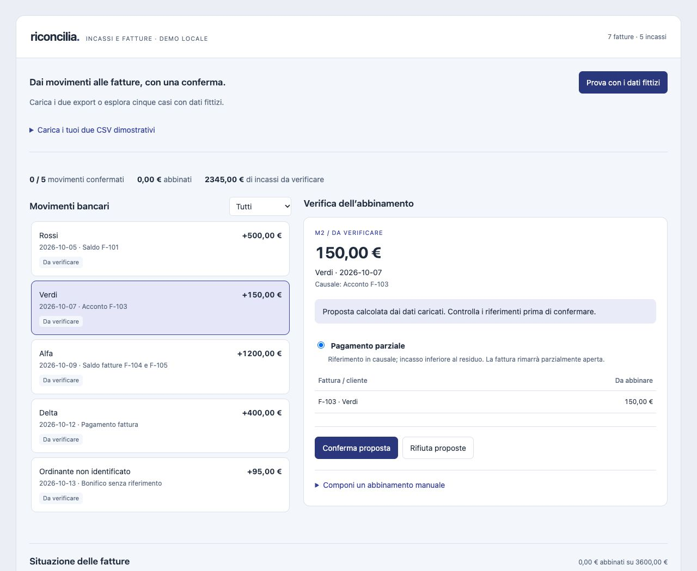

# Riconcilia — incassi e fatture, con verifica dell'operatore

Demo locale di abbinamento tra fatture e incassi bancari. Importa due CSV, calcola proposte motivate, consente di confermarle o rifiutarle e produce riepiloghi esportabili. Le proposte nascono dai dati: non sono predefinite in base agli ID della demo.



## Apri la demo
Estrai lo ZIP e apri `index.html` oppure `dist/Riconcilia_DEMO.html` con doppio clic in un browser moderno. Premi **Prova con i dati fittizi**. Nessuna installazione, connessione al gestionale o credenziale bancaria. Il pacchetto è basato su HTML e JavaScript standard; la verifica diretta è svolta su macOS, non su un PC Windows.

## Il caso dimostrativo
Sette fatture e cinque incassi: riferimento completo (Rossi), acconto di 150 euro su 300 (Verdi), bonifico da 1.200 euro per due fatture da 700 e 500 (Alfa), due fatture Delta da 400 euro entrambe possibili e movimento non identificato da 95 euro.

Confermando Rossi, Verdi, Alfa e una sola delle due fatture Delta:

| Risultato | Importo |
|---|---:|
| Incassi caricati | 2.345,00 EUR |
| Incassi abbinati | 2.250,00 EUR |
| Incassi ancora da verificare | 95,00 EUR |
| Residuo totale delle fatture caricate | 1.350,00 EUR |

L'acconto Verdi lascia un residuo di 150 euro. Delta richiede una scelta esplicita. L'annullamento di una conferma ripristina i residui.

## Importazione
Usa i CSV in `examples/` come modello. Separatore punto e virgola, virgola o tab; intestazioni richieste (ordine libero):

- Fatture: `id_fattura`, `cliente`, `data_fattura`, `importo`.
- Incassi: `id_movimento`, `data_movimento`, `ordinante`, `causale`, `importo`.

Importi positivi in euro, con virgola decimale: `1234,56` o `1.234,56`; senza simbolo valuta. Date reali ISO `AAAA-MM-GG` tra il 1900 e il 2199. Sono accettati solo incassi, non addebiti. ID univoci all'interno di ciascun file, massimo 80 caratteri. Massimo 500 record e 2 MB per file. Intestazioni duplicate, date non valide e righe irregolari bloccano l'importazione. I file sono preparati in memoria; diventano un nuovo lotto solo premendo **Elabora i due file**.

## Criteri delle proposte
1. Cerca riferimenti espliciti agli ID fattura nella causale. Un riferimento già interamente abbinato o successivo al movimento richiede una verifica.
2. Se i riferimenti individuati sono coerenti, propone una fattura, un acconto o un gruppo di fatture. Un ordinante diverso viene evidenziato.
3. In assenza di riferimenti, cerca uguaglianza tra ordinante e cliente normalizzati e confronto con il residuo. Non abbina automaticamente nomi solo simili.
4. Cerca anche somme di due o tre fatture dello stesso cliente, tra le prime 18 aperte ordinate per data. Mostra al massimo 8 proposte e avvisa sui limiti. La ricerca non è esaustiva oltre questi limiti.
5. Se esiste un'unica fattura aperta dello stesso cliente e l'incasso è inferiore al residuo, propone un possibile acconto.

Ogni proposta richiede conferma. Importo uguale non equivale a corrispondenza certa. Più proposte restano senza preselezione. Per casi non coperti è disponibile una selezione manuale delle fatture e dei rispettivi importi. Anche questa scelta richiede che la somma copra esattamente il movimento e non superi i residui. Sono escluse fatture successive alla data dell'incasso: gli anticipi prima dell'emissione non sono gestiti.

## Output
Tre CSV separati, scaricabili senza servizi esterni:

- Fatture e residui.
- Movimenti e stato della verifica.
- Dettaglio degli abbinamenti confermati, motivazione e data/ora della conferma.

Gli importi sono calcolati in centesimi interi. I campi CSV testuali potenzialmente interpretati come formule sono neutralizzati in esportazione. Gli abbinamenti confermati non sono modificati quando si seleziona un altro movimento; si possono annullare esplicitamente.

## Limiti del prototipo
Usare dati fittizi. Nessuna sincronizzazione bancaria, nessun accesso a gestionali, nessuna registrazione contabile, nessuna gestione di IVA, valute multiple, note di credito, commissioni, pagamenti in eccesso o anticipi. Un movimento deve essere interamente distribuito: non si gestisce un residuo del bonifico. I residui sono relativi ai file caricati: non certificano insoluti, ritardi o la situazione contabile reale.

Dati e decisioni restano in memoria: chiudere o ricaricare la pagina li cancella. I CSV esportati sono riepiloghi, non backup da reimportare per riprendere la sessione. La distribuzione dell'HTML include il codice sorgente leggibile. Questa cartella è preparata localmente: non è stata pubblicata su GitHub.

## Sviluppo e verifiche
Nessuna dipendenza JavaScript. Con Node.js:

```sh
node build.cjs
node tests/core.test.cjs
```

Il build ricompone l'HTML autonomo dai file in `src/`. I test coprono importazione, riferimenti, importi, acconti, ambiguità, gruppi di fatture, riuso dei residui, annullamento, limiti ed esportazioni. I CSV di esempio sono rigenerati dai test.

Nella cartella `docs/` sono disponibili tre esportazioni di esempio e i valori attesi del caso dimostrativo (Delta abbinato a F-107). Le esportazioni sono riepiloghi del caso, non dati reali.
